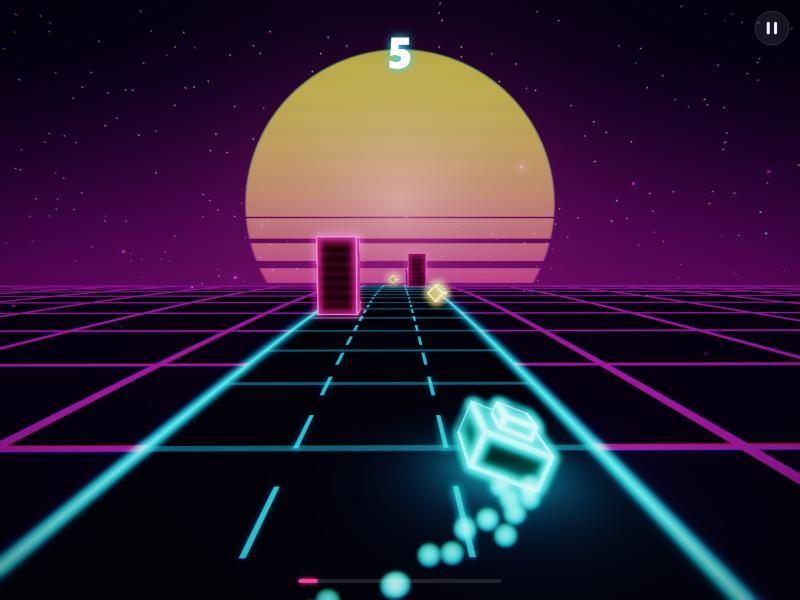
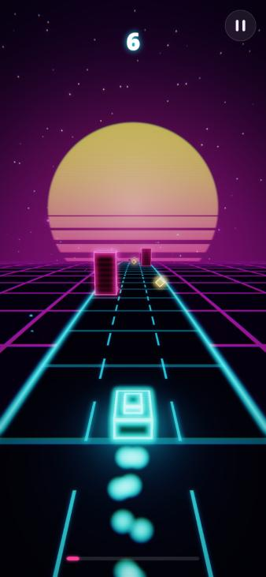
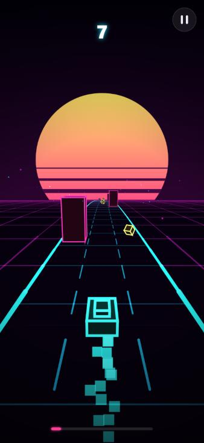

# Prism Dash ◆ 霓虹疾驰

> 一款为 **YouTube Playables** 打造的霓虹合成波（Synthwave）风格 3D 无尽跑酷小游戏。
> 纯 **TypeScript + 原生 WebGL2 + Canvas 2D** 实现，零运行时依赖，gzip 后约 **23 KB**。

**▶ 在线试玩：https://gujingchao.github.io/prism-dash/**
（加 `?debug` 显示性能面板，加 `?renderer=2d` 强制使用 Canvas 2D 渲染器）

| WebGL2（HDR + Bloom） | 移动端竖屏 · WebGL2 | 移动端竖屏 · Canvas2D |
| :---: | :---: | :---: |
|  |  |  |

---

## 玩法

三条跑道，速度会越来越快。左右换道躲开霓虹墙，跳过橙色栅栏，连续吃宝石叠加连击倍率，捡到绿色护盾可以抵挡一次撞击。

| 操作 | 键盘 | 触屏 |
| --- | --- | --- |
| 换道 | ← → / A D | 左右滑动 |
| 跳跃 | ↑ / W / 空格 | 点击 / 上滑 |
| 急降 | ↓ / S | 下滑 |
| 暂停 | Esc / P | 右上角按钮 |
| 切换渲染器 | R | 标题页按钮 |
| 调试面板 | F | — |

计分 = 距离分 + 宝石分（10 × 连击倍率，最高 ×10）+ 擦身而过奖励。

## 技术亮点

### 1. 手写 WebGL2 渲染管线（不依赖 three.js 等引擎）

`src/render/webgl/`

```
Scene FBO（支持 EXT_color_buffer_float 时用 RGBA16F，否则 RGBA8）
  ├─ Sky        全屏三角形（gl_VertexID 生成，不需要顶点缓冲）：渐变、程序化星空、条纹落日
  ├─ Ground     细分平面 + 片元着色器程序化网格（fwidth 抗锯齿、虚线车道、随音乐节拍脉动）
  ├─ Boxes      所有障碍物/宝石/飞船只用 1 次 drawElementsInstanced（13 float/实例）
  └─ Particles  GL_POINTS + 加法混合，按透视缩放点大小
Bloom: Bright-pass + 2× 降采样 → 可分离高斯模糊（利用双线性采样，9 tap 只需 5 次采样）× 2 轮
Composite: 色差 + Bloom 叠加 + ACES 色调映射 + 暗角 + 扫描线 + 受击闪白
```

- **弯曲世界（Curved World）**：顶点着色器里按到相机距离的平方让世界下沉、左右摆动，同样的公式在 CPU 端（`Camera.project`）也实现了一份，所以 HUD 飘字和 Canvas2D 渲染器都能和 GPU 画面严格对齐。
- **霓虹描边**：不用线框，也不用额外 pass。片元着色器用物体空间坐标乘缩放，算出世界单位下到最近棱边的距离，所以不论方块怎么缩放，描边宽度都保持一致。
- **健壮性**：处理 `webglcontextlost` / `webglcontextrestored`（丢失时自动降级到 Canvas2D，恢复后重建全部 GPU 资源）；HDR 帧缓冲创建失败时自动回退到 LDR；渲染异常会被捕获，自动切换渲染器，游戏不会崩溃。

### 2. Canvas 2D 渲染器（降级方案 / 运行时可切换）

`src/render/canvas2d/canvas-renderer.ts`：和 WebGL 共用相机矩阵、弯曲公式和绘制列表，自己实现了 3D 投影、画家算法排序、屏幕空间背面剔除、平面光照、距离雾和 `lighter` 加法混合粒子。按 **R** 键可以在两套渲染器之间实时切换，对比效果。

### 3. 架构

```
src/
├─ game/        纯逻辑层：无 DOM、无渲染，可以在 Node 里单测
│  ├─ world.ts      固定步长模拟、碰撞、计分、连击、护盾、标题页自动驾驶
│  ├─ spawner.ts    种子化关卡生成（保证每行至少一条可通过的路）
│  └─ collision.ts  AABB
├─ render/      表现层
│  ├─ camera.ts     追尾相机，竖屏自适应 FOV（保证三条道都在画面里）
│  ├─ scene.ts      Renderer 接口 + 两个后端共用的绘制列表
│  ├─ particles.ts  Struct-of-Arrays 粒子池（单个 Float32Array，零 GC）
│  ├─ hud.ts        Canvas 2D HUD：滚动分数、连击环、飘字、调试面板
│  ├─ webgl/        WebGL2 后端
│  └─ canvas2d/     Canvas 2D 后端
├─ audio/       WebAudio 实时合成全部音效 + look-ahead 步进音序器背景音乐（不用任何音频文件）
├─ platform/    YouTube Playables SDK 封装（YouTube 外自动降级）
├─ core/        数学库（列主序矩阵）、种子随机数、统一输入（键盘/触摸/鼠标）
└─ app.ts       主循环与模块串联
```

- **固定步长模拟**（120 Hz）+ 累加器，和显示器刷新率解耦；在 60/120/144 Hz 屏幕上手感一致，结果也是确定性的（有单测验证同种子同输入得到同样结果）。
- **事件队列**：逻辑层只往 `world.events` 推送事件，音频、粒子、HUD 每帧统一消费，逻辑和表现完全解耦。
- **热路径零分配**：实体对象池、粒子 SoA、预分配矩阵和实例缓冲。
- **动态分辨率**：持续掉帧时自动降低内部渲染分辨率，DPR 上限为 2。

### 4. YouTube Playables 接入

`src/platform/playables.ts`，对照 Playables 的要求逐项实现：

| 要求 | 实现 |
| --- | --- |
| 加载 SDK | `index.html` 里在游戏代码之前引入 `https://www.youtube.com/game_api/v1` |
| `firstFrameReady()` / `gameReady()` | 第一帧真正画出来之后调用 |
| `onPause` / `onResume` | 暂停模拟、挂起 AudioContext、停掉 rAF；游戏中恢复时保留暂停界面，由玩家自己继续 |
| `isAudioEnabled` / `onAudioEnabledChange` | 和游戏内静音开关合并控制主音量（在 YouTube 内隐藏游戏自带的静音按钮） |
| `loadData` / `saveData` | 云存档（最高分、偏好设置）；YouTube 外回退到 localStorage |
| `sendScore` | 刷新最高分时上报整数分数 |
| `getLanguage` | 中英文本地化 |
| `health.logError/logWarning` | 渲染异常、存档失败时上报 |
| 包体积 / 无外部请求 | 所有资源都是代码生成的：着色器、音效、图标（SVG data URI），构建时 `base: './'` |
| 移动端 | 竖屏优先，安全区适配，`touch-action: none`，滑动在越过阈值时立即触发 |

### 5. HTML5 / CSS

DOM + CSS 负责菜单层（标题页、结算面板、暂停），Canvas 负责游戏内 HUD，各司其职。用到了 CSS 渐变文字 + 多层 `drop-shadow` 霓虹灯效、闪烁/脉冲关键帧动画、`backdrop-filter` 毛玻璃、`env(safe-area-inset-*)`、`(pointer: coarse)` 区分触屏和桌面的操作提示，以及 `prefers-reduced-motion` 无障碍适配。

## 本地运行

```bash
npm install
npm run dev        # http://localhost:5173
npm test           # Vitest 单元测试（数学库、关卡生成约束、物理/碰撞/计分、确定性）
npm run build      # 类型检查 + 生产构建，输出到 dist/
```

打包上传到 Playables 时，把 `dist/` 目录里的内容压缩成 zip 即可。

## 可调参数

所有手感参数都在 `src/config.ts` 里：速度曲线、重力、跳跃初速度、换道阻尼、弯曲强度、雾距、配色等。

URL 参数：`?seed=123` 固定关卡种子，`?renderer=2d` 强制使用 Canvas2D，`?debug` 打开调试面板，`?lang=en|zh` 指定语言。

## License

MIT
